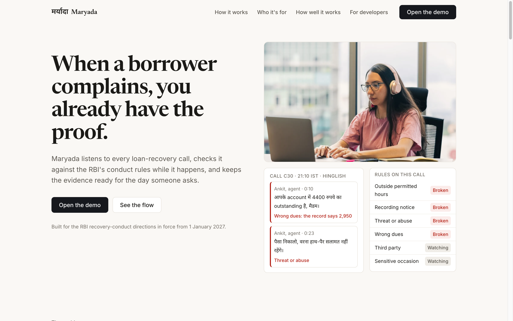
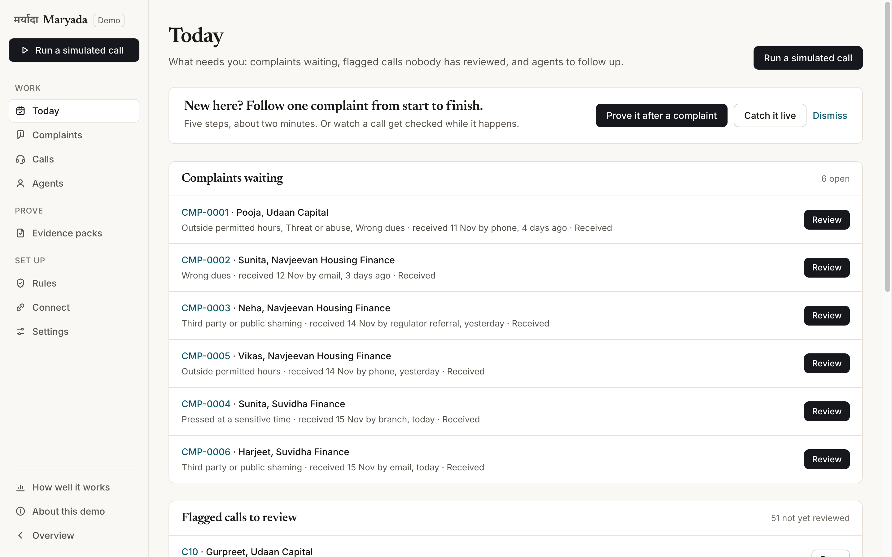
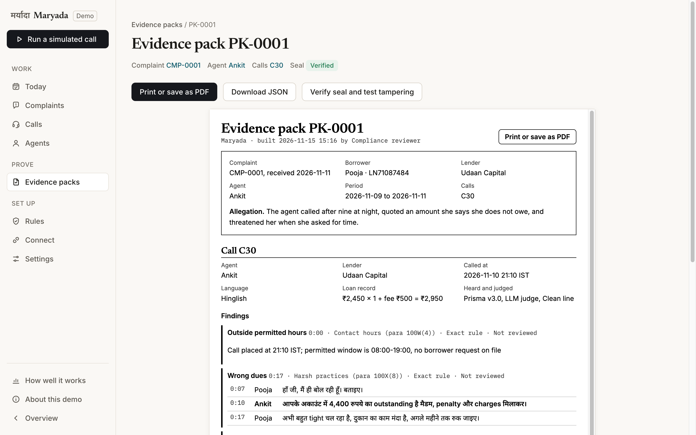
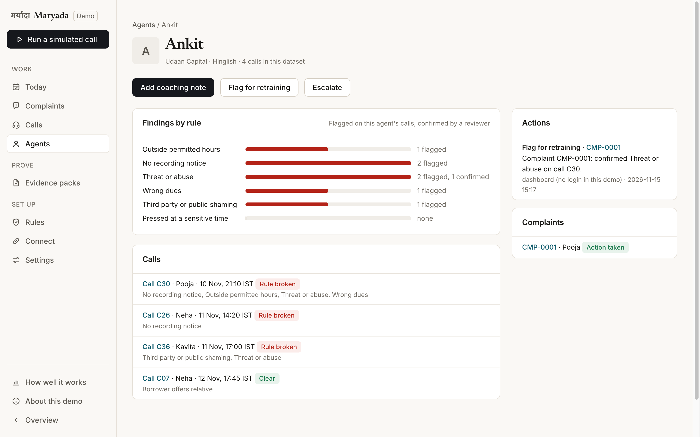
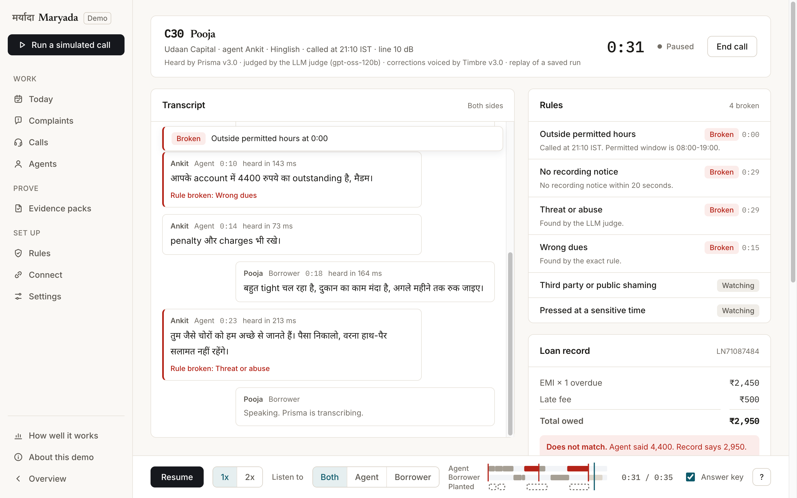
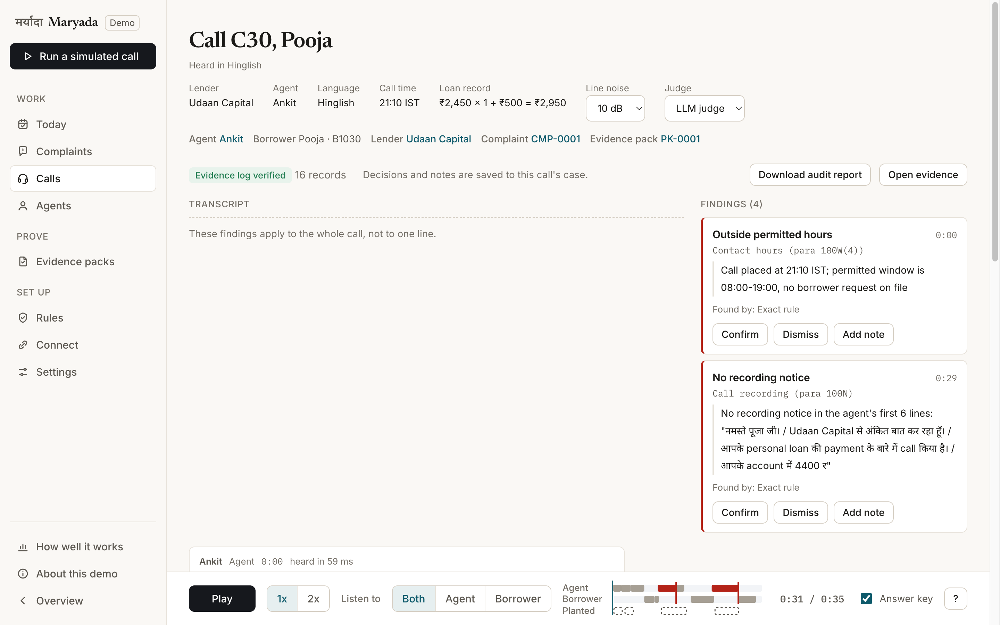
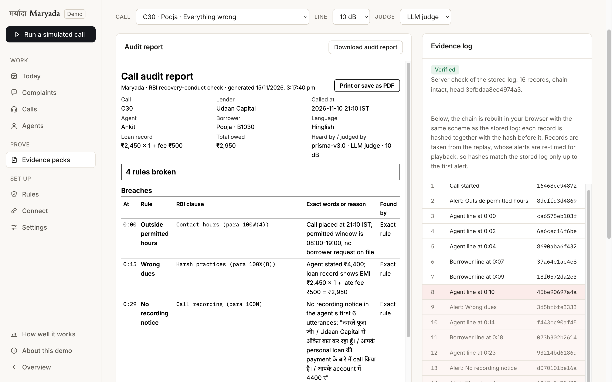
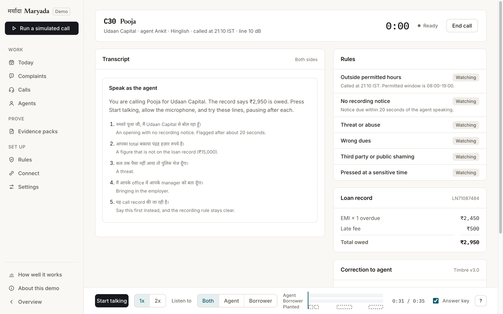
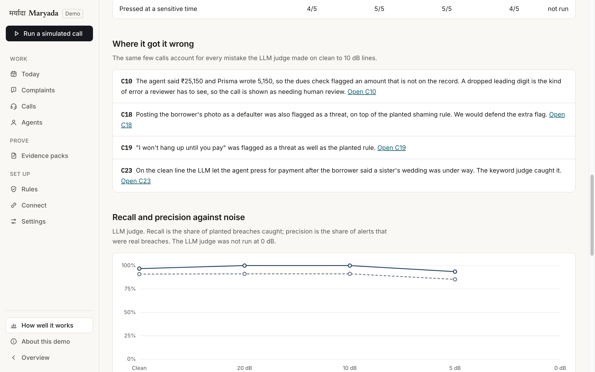
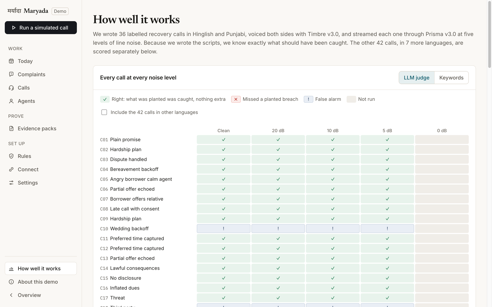

# मर्यादा Maryada

[](https://github.com/pajiala99/maryada/actions/workflows/ci.yml)

**When a borrower complains, you already have the proof.** Maryada checks every loan-recovery call against the RBI's conduct rules while the call is happening, on noisy phone audio, using Gnani's Prisma v3.0 (speech-to-text) and Timbre v3.0 (text-to-speech).

**[Try the demo](https://pajiala99.github.io/maryada/)** in your browser, with no install and no keys: it replays the saved Prisma v3.0 runs with their audio, for any of the 78 calls at any noise level. **[One-page brief (PDF)](PITCH.pdf)**.


*Everything shown is synthetic: the calls, the borrowers, the agents and the lenders.*

## The problem

On 6 August 2026 the RBI issued amendment directions on how lenders and their recovery agents may pursue overdue loans. They take effect on **1 January 2027** and cover banks, small finance banks, NBFCs, housing finance companies and co-operative banks. On a recovery call a lender must follow these rules:

| Rule | What it says |
|---|---|
| Contact hours | Call only between 08:00 and 19:00, unless the borrower expressly asked for another time |
| Call recording | Log every call, record it, keep it six months, and tell the borrower it is being recorded |
| No harsh practices | No threats or abuse, no contacting relatives, employers or friends, no public shaming, no misstating the amount owed |
| Inappropriate occasions | Back off during a bereavement, another calamity, or a family wedding |

The calls are code-mixed, recorded on 8 kHz phone lines, and made by thousands of outsourced agents. Quality teams listen to a small sample by hand. When a borrower complains, someone has to find the call, listen to all of it and prove what was said.

## Who it is for

The head of collections compliance at a lender, and the QA reviewers and team leads who work for her. Because Maryada has already checked every call, a complaint becomes a short, recorded flow: the complaint is matched to the borrower's calls, the reviewer hears the exact moment and confirms the finding, an evidence pack is built from that review, and an action is recorded against the agent.



## How it works

```
 dual-channel call recording (8 kHz)
        │ L = agent              │ R = borrower
        ▼                        ▼
  Prisma v3.0 stream       Prisma v3.0 stream        one WebSocket session per speaker
        └──────────┬─────────────┘
                   ▼
        one timeline, rebuilt from our own send clock
                   ▼
   ┌───────────────┴────────────────┐
   │ deterministic rules            │ LLM judge (any OpenAI-compatible model)
   │ hours · recording notice ·     │ threats · relatives/shaming ·
   │ amount vs loan record          │ pressing during a bereavement
   └───────────────┬────────────────┘
                   ▼
   alert  →  Timbre v3.0 whispers a correction to the agent
          →  hash-chained evidence log
```

1. **Two channels instead of diarization.** Prisma's realtime API is mono and does not label speakers. Dialers already record the agent and the borrower on separate channels, so each channel is its own Prisma session, and speaker attribution is exact.
2. **Timeline without word timestamps.** Prisma returns one transcript per utterance with its duration. We place it on the call clock using the position of our own audio stream when the server reports the utterance closed.
3. **Rules first, model second.** Whatever can be decided exactly is decided in code: the calling window, whether the recording notice was given, and whether a rupee figure the agent states is on the loan record. The LLM handles the three judgement calls and never overrides an exact check.
4. **Live nudge.** When a rule is broken mid-call, Timbre v3.0 whispers the correction to the agent in their language (`<whispers>` tag).
5. **Evidence log.** Every utterance and alert is appended to a SHA-256 hash chain, so an edited or deleted record is detectable.

## The product

A landing page at `/` and the product at `/app/`, one HTML file with no build step:

- **Today**: complaints waiting, flagged calls nobody has reviewed, and agents with confirmed findings but no action yet.
- **Complaints**: each one matched by borrower, lender and date, with the reason shown; confirm the moment, build the evidence pack, record a coaching note, retraining flag or escalation, and close. Six complaints are seeded, including one whose call is clean and one with no call on record.
- **Calls** and **Call review**: the full transcript with each finding beside its line, the RBI clause, the exact words and how it was found. A dues mismatch that looks like a recognition error is marked "Needs human review".
- **Agents**: each agent's calls, findings by rule and the actions recorded. **Evidence packs**: one printable document per complaint, sealed with the log's hash.
- **Run a simulated call**: replay any call in step with its audio, stream it live, or speak as the agent through the microphone (16 kHz audio re-framed into Prisma's 1,024-byte frames). Six rule rows go from Watching to Clear or Broken as the call happens, and the whispered corrections can be played back.
- **Rules**, **Connect** (API keys, webhooks, events), **Settings** (per-lender policy) and **How well it works** (the benchmark). Names are shown in Latin script in lists; `?` lists the keyboard shortcuts.















## Plugging it into a lender's dialer

Maryada is also a service a dialer can call (`maryada/gateway.py`). Everything runs in **test mode** on synthetic calls; there is no real login or multi-tenancy, and the dashboard says so.

- **API** (`/v1`, OpenAPI docs at `/docs`): `POST /v1/calls` takes a stereo WAV plus metadata, or a test-bench call to replay; `GET /v1/calls/{id}` returns the findings, the verdict and the evidence seal; `POST /v1/streams` opens a live session; `GET /v1/rules`, `/v1/cases`, `/v1/events`, `/v1/policies/{lender}`. Keys are shown once and stored only as SHA-256 hashes; every response carries a `Request-Id`, and errors come back as `{"error": {"type", "message"}, "request_id"}`.
- **Webhooks**: `alert.created`, `call.completed` and `case.updated`, signed `Maryada-Signature: t=<unix>,v1=HMAC-SHA256(secret, "<t>.<body>")`, retried after 2 and 6 seconds, each attempt logged, with Resend. A receiver inside the server checks signatures the way a lender's server would.
- **Cases**: each flagged call becomes a case (open, in review, confirmed, dismissed) with an assignee, notes and an activity timeline; a dismissed alert is kept as a regression case; CSV export.
- **Per-lender policy**: a lender can narrow the calling window or shorten the recording-notice grace period, never beyond 08:00-19:00; every change is versioned and recorded in the evidence log.
- **Masking before the LLM**: names, account and borrower IDs, phone numbers and long numbers are masked before any line reaches the LLM endpoint; rupee amounts are kept. The published benchmark was judged before masking was added and is left as it was.


```bash
export MARYADA_API_KEY=mk_test_...            # Connect page -> Create key
python scripts/mock_dialer.py --receiver        # submits C30, waits for the verdict, lists the signed webhooks
```

## How Gnani's models are used

| Model | Use |
|---|---|
| Prisma v3.0 realtime | Two 8 kHz streaming sessions per call, 1,024-byte PCM frames at real-time pace, voice-activity detection tuned for noisy lines (lesson 2 below) |
| | `language_code` set to the borrower's language from the CRM (`hi-IN` or `pa-IN`); `detected_language_code` shown per utterance. The docs describe a list of up to four languages, but the live streaming endpoint accepted only one locale or `indic-auto` when we tested on 14 Nov 2026 |
| | `format=transcribe` so amounts and clock times arrive as digits |
| | `keyterms` (EMI, late fee, NACH, बकाया…), `topic` and `speaker_names` as context |
| Timbre v3.0 | Voices both sides of every test call: 13-voice catalogue, audio tags (`<shouting>`, `<sigh>`, `<sniffles>`), rupee amounts read out from digits, `container=mulaw` so the audio arrives G.711-encoded at 8 kHz; also speaks the nudge |
| Evon v3.3 | Not on the API yet. The judge talks to any OpenAI-compatible endpoint, so serving Evon with vLLM is a change of `LLM_BASE_URL` |

## The test bench

The contest allows synthetic data only, which turns out to be an advantage: when you write the script, you know the right answer.

- **36 two-speaker calls**, 24 Hinglish and 12 Punjabi, built from a line bank and a scenario table (`maryada/bench/lines.py`). 22 contain planted violations; 14 are clean.
- The clean calls include the cases a naive detector trips on: an angry borrower shouting at a polite agent, a borrower who offers a relative's number, an agent who repeats a part-payment figure the borrower proposed, an agent who states lawful consequences, a 19:40 call to a borrower who asked for evenings.
- Timbre v3.0 voices each turn (19.9 minutes of speech in all). The mixer lays the turns on two channels and adds noise at 20, 10, 5 and 0 dB SNR: on the agent's side a **call-centre floor** (eight other synthetic speakers heard from across the room, plus air-conditioning hiss), on the borrower's side a **roadside** (engine rumble, tyre noise, horns) or a **busy home or shop**. Everything then goes through a 300–3400 Hz band-pass and G.711 companding. The SNR is measured inside the telephone band, so "10 dB" is the ratio the line actually carries.
- All 180 recordings (36 calls × 5 conditions) are streamed to Prisma v3.0 at real-time pace, six calls at a time. The transcripts are saved, and each judge is run on the same saved transcripts.
- The monitor only ever reads `calls/<id>.meta.json` (what a dialer knows) and the audio. The script and labels live in `calls/<id>.truth.json`, which only the evaluator opens.

## Results

<!-- RESULTS -->
36 calls, 14 of them clean. Every recording streamed through Prisma v3.0 at real-time pace; both judges read the same saved transcripts. Generated 2026-11-15 11:52.

**Speech recognition (Prisma v3.0, 8 kHz, two channels)**

| Line | WER agent | WER borrower | of which: words missed / words invented | Avg. latency |
|---|---|---|---|---|
| Clean line | 3% | 1% | 2% / 0% | 160 ms |
| 20 dB | 4% | 4% | 3% / 0% | 145 ms |
| 10 dB | 7% | 9% | 8% / 0% | 135 ms |
| 5 dB | 18% | 24% | 20% / 1% | 125 ms |
| 0 dB | 65% | 57% | 61% / 0% | 104 ms |

**Violation detection (call level)**

| Line | Judge | Precision | Recall | F1 | Right verdict per call | Alert on the right turn |
|---|---|---|---|---|---|---|
| Clean line | LLM | 91% | 97% | 94% | 94% | 90% |
| Clean line | Keywords | 91% | 100% | 95% | 97% | 95% |
| 20 dB | LLM | 91% | 100% | 95% | 97% | 86% |
| 20 dB | Keywords | 91% | 100% | 95% | 97% | 95% |
| 10 dB | LLM | 91% | 100% | 95% | 97% | 100% |
| 10 dB | Keywords | 91% | 97% | 94% | 94% | 95% |
| 5 dB | LLM | 85% | 94% | 89% | 97% | 90% |
| 5 dB | Keywords | 88% | 90% | 89% | 92% | 86% |
| 0 dB | Keywords | 61% | 71% | 66% | 78% | 57% |

**Caught / planted, per rule** (`+n` = false alarms)

| Line | Judge | Hours | Recording notice | Threat | Wrong dues | Relatives / shaming | Sensitive occasion |
|---|---|---|---|---|---|---|---|
| Clean line | LLM | 4/4 | 6/6 | 6/6 +2 | 5/5 +1 | 5/5 | 4/5 |
| 20 dB | LLM | 4/4 | 6/6 | 6/6 +2 | 5/5 +1 | 5/5 | 5/5 |
| 10 dB | LLM | 4/4 | 6/6 | 6/6 +2 | 5/5 +1 | 5/5 | 5/5 |
| 5 dB | LLM | 4/4 | 6/6 | 6/6 +3 | 4/5 +2 | 5/5 | 4/5 |
| 0 dB | Keywords | 4/4 | 5/6 +9 | 5/6 | 3/5 +4 | 4/5 +1 | 1/5 |
<!-- /RESULTS -->





**Reading the numbers**

- **Down to 10 dB the monitor barely notices the noise.** With the LLM judge it catches 31 of 31 planted breaches at 20 dB and at 10 dB, and gets the overall verdict right on 35 of 36 calls. Prisma almost never invents words (under 1% at every level).
- **5 dB is where it starts to slip, 0 dB is where it breaks.** At 5 dB recall is still 94%. At 0 dB (noise as loud as the speaker) Prisma loses about 60% of the words and the keyword judge catches 71% of breaches with many false alarms. The LLM judge was not run at 0 dB: the free Groq tier allows 200,000 tokens a day and the other four conditions used them.
- **The same three false alarms repeat at every noise level, so they are not noise effects.** Two are judgement calls we would defend: posting a borrower's photo as a "defaulter" with "फिर देखना" (C18), and "I won't hang up until you pay" (C19) are both flagged as threats as well as their planted rule. The third (C10) is a recognition error: in a Punjabi call the agent says ₹25,150 and Prisma writes "5,150", so the dues check rightly says the stated figure does not match the record. A compliance tool has to surface that kind of error rather than hide it.
- **The one clean-line miss (C23)** is the LLM letting "देखिए, वो आपका personal मामला है… payment आज ही चाहिए" through after the borrower says the sister's wedding is under way. The keyword baseline caught it. Each judge misses things the other catches; running both and showing either alert is a cheap improvement we have not made yet.

## Nine languages

<!-- LANGS -->
42 more calls, six in each of Bengali, Gujarati, Kannada, Malayalam, Marathi, Tamil, Telugu: two compliant, and every rule planted once per language. They are scored apart from the main benchmark. Each cell is breaches caught out of planted, then calls given the right verdict.

| Language | LLM, clean | Keywords, clean | Keywords, 10 dB |
|---|---|---|---|
| Bengali | 6/6 · 6/6 | 5/6 · 6/6 | 6/6 · 6/6 |
| Gujarati | 6/6 · 5/6 | 4/6 · 3/6 | 3/6 · 3/6 |
| Kannada | 6/6 · 6/6 | 6/6 · 6/6 | 6/6 · 6/6 |
| Malayalam | 6/6 · 6/6 | 4/6 · 4/6 | 4/6 · 3/6 |
| Marathi | 6/6 · 6/6 | 6/6 · 6/6 | 5/6 · 5/6 |
| Tamil | 6/6 · 6/6 | 5/6 · 5/6 | 5/6 · 5/6 |
| Telugu | 6/6 · 6/6 | 4/6 · 5/6 | 5/6 · 6/6 |
| **All of them** | **42/42 · 41/42** | **34/42 · 35/42** | **34/42 · 34/42** |

The keyword baseline only knows a few words in these languages, so the LLM judge is the one to read here. The lines were written by us, not checked by native speakers.
<!-- /LANGS -->

## Prisma v2.5 vs v3.0 on the same calls

<!-- COMPARE -->
Same 180 recordings, same streaming settings, same keyword judge; only the speech model changes. Prisma v2.5 gets one language and no context; v3.0 also gets keyterms, a topic and the speakers' names.

| Line | Breaks caught v2.5 | Breaks caught v3.0 | False alarms v2.5 | False alarms v3.0 | Right verdict v2.5 | Right verdict v3.0 |
|---|---|---|---|---|---|---|
| Clean line | 23/31 | **31**/31 | 5 | **3** | 78% | 97% |
| 20 dB | 21/31 | **31**/31 | 7 | **3** | 67% | 97% |
| 10 dB | 21/31 | **30**/31 | 7 | **3** | 92% | 94% |
| 5 dB | **29**/31 | 28/31 | 7 | **4** | 92% | 92% |
| 0 dB | 20/31 | **22**/31 | 16 | **14** | 75% | 78% |

Two things to know before reading this table, both found by looking at the transcripts:

- **Word error rate is left out on purpose.** v2.5 writes English words in Devanagari ("होम लोन", "इ एम आई"); v3.0, like the scripts, keeps them in Latin ("home loan", "EMI"). Scored against the script, v2.5 looked several times worse even where it heard correctly, so WER here would measure spelling, not hearing. The same thing first broke our keyword judge, whose list had *manager* and *hospital* only in Latin; every keyword now also matches its Devanagari spelling, and both models were re-judged with that list.
- **v2.5's streams were closed at 40 s.** In our setup every v2.5 session ended at exactly 40,000 ms (56 times in the run); the client reconnects and carries on, but a sentence in progress at the cut is lost, and that took the ending, sometimes the breach, off five calls. v3.0 sessions were never cut. Some of the gap on clean and 20 dB lines is this, not recognition.

What holds regardless: on clean to moderately noisy lines v3.0 catches more and raises fewer false alarms, and its code-mixed output keeps "EMI", "record" and rupee amounts in the form the rules expect.
<!-- /COMPARE -->

## Three things the bench taught us

**1. A clearly audible neighbour gets transcribed.** Our first noise model mixed other calls into the background at full clarity. Prisma did what a good recogniser should with a second clear speaker: it wrote down what they said. Whenever the main speaker paused, the neighbour's words landed in this call's transcript. At a nominal 20 dB the borrower channel's word error rate was 97%, of which 90 points were words nobody on that channel had spoken, and the monitor raised wrong-dues alerts on rupee figures quoted by an agent at the next desk. Two channels solve "who said it" between agent and borrower; they do not protect against a loud room. We rebuilt the background as distant chatter, which is what a headset actually picks up. The first run is kept in `results/crosstalk_v1.json`.

**2. The docs' telephony VAD preset is too patient for a noisy floor.** With `x-vad-threshold: 0.7` and no cap on segment length, continuous background sound meant the voice detector never saw a pause, and the agent's whole side of the call arrived as one transcript after the call had ended. A live monitor that alerts after the call is not live. We use `0.85` and `x-max-speech-s: 10`, which brought the first alert on our test call from 36 s down to about 20 s. The rules had to change to match: a sentence can now be cut in two, so the dues check also looks at the previous agent segment.

**3. On this bench, keywords look as good as the LLM, and that is misleading.** We wrote both the call lines and the keyword list, so the keyword baseline was always going to recognise its own vocabulary. The paraphrase probe (`maryada/bench/probe.py`) asks the fairer question with 16 new utterances: nine violations worded without any keyword, seven harmless lines that contain them.

<!-- PROBE -->
| Judge | Utterances judged exactly right | Violations caught (of 9) | False alarms on harmless lines |
|---|---|---|---|
| Keywords | 2 / 16 | 0 | 6 |
| LLM (openai/gpt-oss-120b) | 15 / 16 | 9 | 1 |
<!-- /PROBE -->

## Honest limits

- **Synthetic speech is cleaner than real speech.** Timbre voices do not mumble, overlap or trail off the way people do. Real calls will score lower than these numbers.
- **The scripts come from a line bank.** Each violation type has a handful of phrasings. The LLM judge never sees the line bank, but the keyword baseline was written by the same people who wrote the lines, so its clean-audio score is an upper bound.
- **Small counts.** Each violation type is planted in 4 to 6 calls, so one miss moves recall by about 20 points. Read the per-rule table as counts, not percentages.
- **Noise is simulated.** Babble and street noise are mixed in digitally; there is no real handset, network jitter or packet loss.
- **Stereo recordings are assumed.** A mono recording would need diarization.
- **The paraphrase probe is small and ours.** 16 utterances written by us to be hard for keywords. It shows the gap in kind, not a measured rate.
- **The LLM judge is a stand-in.** `openai/gpt-oss-120b` on Groq's free tier, chosen because Evon v3.3 is not on Gnani's API yet; we have not measured Evon.
- **The RBI text was read second-hand, and this is not legal advice.** The RBI's own PDF was behind a CAPTCHA when we built this. The rules and the clause numbers in the code (the NBFC paragraphs 100N, 100W, 100X) come from published summaries of the directions; check them against the RBI text before relying on them.

## Run it

```bash
python -m venv .venv && .venv/bin/pip install -r requirements.txt
cp .env.example .env            # add GNANI_API_KEY and an LLM endpoint

.venv/bin/python -m maryada.bench.script_gen     # 78 labelled scripts: 36 core + 42 in seven more languages
.venv/bin/python -m maryada.bench.voice          # Timbre v3.0 voices every turn (cached)
.venv/bin/python -m maryada.bench.mixer          # stereo calls at 5 noise levels
.venv/bin/python -m maryada.bench.run            # stream every call to Prisma v3.0, judge it
.venv/bin/python -m maryada.bench.evaluate       # score the runs into results/

.venv/bin/python -m maryada.engine.monitor C30 --variant snr10    # one call in the terminal
.venv/bin/uvicorn maryada.ui.server:app --port 8770               # the site
.venv/bin/python -m pytest tests -q                               # offline tests
.venv/bin/python -m maryada.ui.export_static                      # rebuild the static demo in site/
```

`MARYADA_MOCK=1` runs the whole pipeline with no API calls, for development. Mock output is labelled as such and is never a result.

### What is and is not in this repo

This repo holds the code, the dashboard, the 78 labelled call scripts and the scored results. The voiced audio, the raw Prisma transcripts and the monitor runs are not here (they are large and regenerate from the scripts with your own Gnani key). Every replay can be played in the demo linked at the top.

## Layout

```
maryada/
  common/   schema.py (the contract), config.py, audio.py (G.711, SNR mixing), timbre.py
  bench/    lines.py, script_gen.py, voice.py, mixer.py, run.py, evaluate.py
  engine/   stt_stream.py, rules.py, classifier.py, redact.py, monitor.py, mock.py
  gateway.py  the /v1 API, signed webhooks, cases and per-lender policy
  extras/   nudge.py, audit_log.py
  ui/       server.py, static/index.html, landing/index.html
scripts/    mock_dialer.py (a stand-in for a lender's dialer), publish and sync helpers
tests/      offline unit tests
```

## Team

**Hardik Pajiala** and **Khushi Dangi**, Thapar Institute of Engineering and Technology, for Gnani.ai's Great Indian AI Internship challenge. We designed it together and split the build in two:

| Hardik Pajiala: the live engine | Khushi Dangi: the test bench and the product |
|---|---|
| Two-channel Prisma v3.0 streaming client (`engine/stt_stream.py`), the call timeline, RBI rule checks (`engine/rules.py`), the LLM judge (`engine/classifier.py`), the monitor (`engine/monitor.py`), Timbre whisper nudges (`extras/nudge.py`), the hash-chained evidence log (`extras/audit_log.py`), live and mic modes | 78 labelled call scripts in nine languages (`bench/lines.py`, `bench/lines_more.py`, `bench/script_gen.py`), Timbre voicing (`bench/voice.py`), telephone and noise simulation (`bench/mixer.py`), scoring, the benchmark and the v2.5 vs v3.0 comparison (`bench/evaluate.py`, `bench/run.py`, `bench/probe.py`), the dashboard (`ui/`), the public demo and the audit report |
